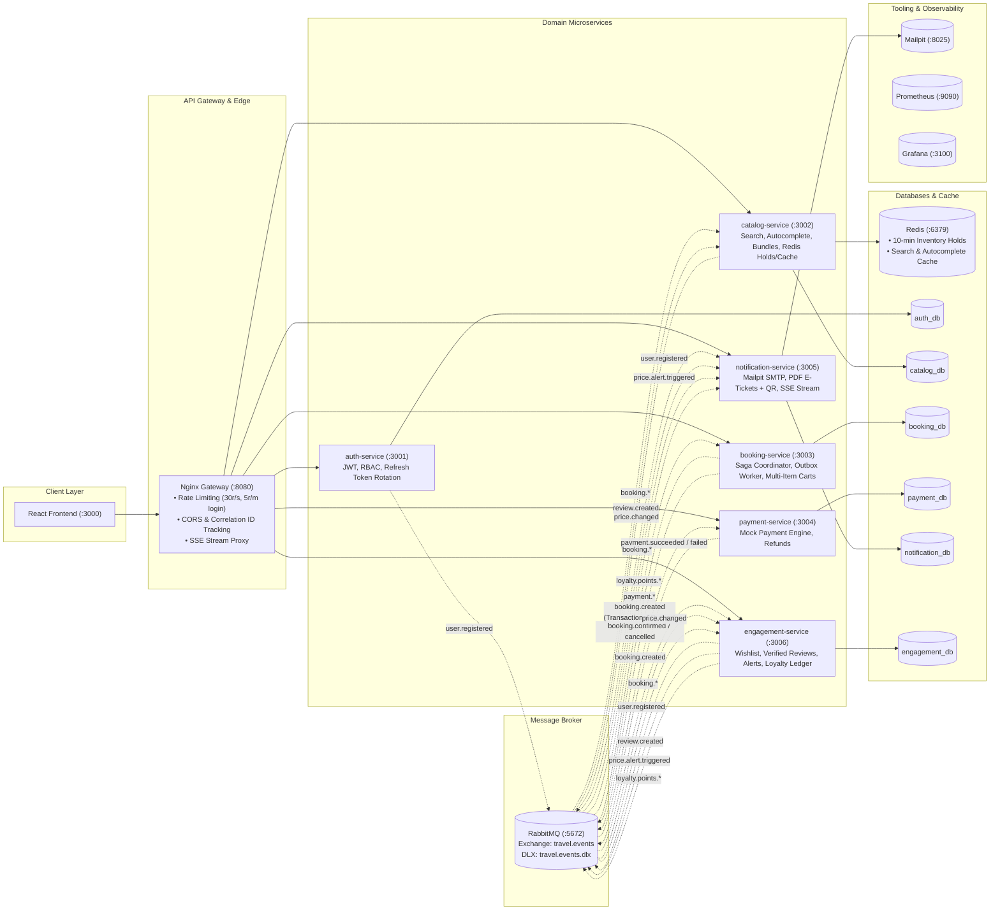

# ✈️ Travel Booking System

[](https://github.com/ZamanAsad007/Travel-Booking-System/actions/workflows/ci.yml)
[](https://nodejs.org/)
[](https://www.docker.com/)
[](CHANGELOG.md)
[](LICENSE)

A production-grade, event-driven microservices travel booking application (flights, luxury hotels, and bundled vacation packages) built with **Node.js 20**, **Express**, **React + Vite**, **PostgreSQL**, **RabbitMQ**, and **Redis**. Designed to demonstrate strict service boundaries, distributed transactions using the **Saga Choreography Pattern**, transactional outbox reliability, real-time status streaming via **Server-Sent Events (SSE)**, dynamic pricing algorithms, and full containerization with **Docker Compose**.

Runs 100% locally with a single command — no external cloud hosting required.

---

## 🏛 Architecture Diagram



---

## ✨ Features Overview

### 1. Core Architecture & Choreographed Saga
- **Microservice Autonomy**: 6 dedicated Node.js Express services, each with its own isolated PostgreSQL database schema enforcing bounded contexts.
- **Saga Choreography Pattern**: Decentralized distributed transactions across booking, inventory holding, payment processing, notification dispatch, and inventory release/refunds without a central orchestrator.
- **Transactional Outbox Pattern**: Atomic local database transactions saving booking changes and outbox events in the same commit, polled and published asynchronously to RabbitMQ to eliminate dual-write event loss.
- **Durable Event Deduplication**: Idempotent message handlers backed by `processed_events` tables in each service database.
- **Dead-Letter Exchange (DLQ) & Exponential Retries**: Automatic exponential retry backoff (`travel.events.dlx`) with an in-memory replayable dead-letter store.

### 2. Search Upgrade & Trip Bundles
- **Redis Query Caching**: High-throughput in-memory caching for flight and hotel search queries with automated TTL and event-driven invalidation on price or inventory changes.
- **Live Autocomplete Endpoint (`GET /api/catalog/suggest?q=`)**: Substring & prefix suggestions across airport codes, major cities, airlines, and luxury hotels.
- **Advanced Filtering & Sorting**:
  - *Flights*: Filter by origin/destination, price range, flight duration (hours), airline, minimum star rating, and sort by departure, duration, rating, or price.
  - *Hotels*: Filter by city, price range, star rating, free cancellation eligibility, and sort by rating, price, or name.
- **Vacation Trip Bundles (`GET /api/catalog/bundles`)**: Generates combined flight + luxury hotel package offers with an automated **15% combo discount**, supporting seamless multi-item cart bookings.

### 3. Roles, Admin Dashboard & Inventory Management
- **Role-Based Access Control (RBAC)**: Signed `USER` and `ADMIN` claims in stateless JWTs with dedicated `requireRole('ADMIN')` authorization middleware.
- **Admin Inventory CRUD**: Complete management endpoints to create, update, and delete flights, hotels, and room types with price history tracking.
- **Business Intelligence & Analytics**: SQL aggregation queries calculating total booking volume, gross revenue, top travel routes, and booking statuses (`GET /api/bookings/admin/stats`).
- **Interactive Admin Dashboard (`/admin`)**: React management interface with inventory tables, CRUD modal forms, and booking metrics.

### 4. Multi-Passenger Booking & E-Ticket PDF with QR Code
- **Multi-Passenger Support**: Collects full traveler records (names, passport numbers, dates of birth, seat preferences) with dynamic passenger-count price scaling.
- **Cryptographic E-Ticket Issuance**: Unique ticket number generated upon booking confirmation.
- **PDF Generation & Scannable QR Codes**: In-memory ticket PDF creation (`pdfkit`) with scannable QR verification code (`qrcode`) attached to confirmation emails and downloadable via `/api/bookings/:id/ticket/download`.

### 5. Promo Coupons & Dynamic Pricing Engine
- **Flexible Promo Engine**: Percent-based (`PERCENT`) and flat (`FLAT`) coupon discounts with minimum spend constraints, expiration windows, maximum global redemptions, and per-user redemption enforcement.
- **Coupon Validation Endpoint (`POST /api/bookings/coupons/validate`)**: Pre-checkout discount calculation and balance verification.
- **Dynamic Pricing Rules**: Pure algorithmic pricing function calculating automatic surcharges for weekend departures (+15%) and peak travel seasons (Summer Peak +20%, Holiday Peak +25%).
- **Compensating Coupon Release**: Automatic reversal and restoration of redeemed coupons if a booking fails or is cancelled.

### 6. Real-Time Status Updates via Server-Sent Events (SSE)
- **Live Event Streaming (`GET /api/notifications/stream/bookings`)**: Real-time push updates delivering instant booking confirmation, cancellation, and payment status events directly to connected clients.
- **Proxy-Optimized Gateway**: Nginx configured with `proxy_buffering off` and extended read timeouts for uninterrupted HTTP streaming.
- **Adaptive Frontend Hook (`useBookingStatus`)**: EventSource client providing toast notifications and status updates with automated fallback to polling upon disconnection.

### 7. Engagement Microservice (Wishlist, Reviews, Price Alerts, Loyalty)
- **Wishlist**: Allows travelers to save flights and hotels with one-click toggles and personal wishlist management.
- **Verified Customer Reviews**: Review submission restricted strictly to travelers with verified confirmed trips (`completed_trips`), publishing `review.created` events to denormalize and update average star ratings in the catalog database.
- **Price History & Drop Alerts**: Automatic tracking of price changes in `price_history`. When catalog prices drop below user-defined targets, `price.alert.triggered` events dispatch email alerts.
- **Loyalty Rewards Ledger**: Append-only transactional ledger tracking points earned on confirmed bookings, automatic deductions on cancellations, welcome signup bonuses, and dynamic tier calculation (**Bronze**, **Silver**, **Gold**).

### 8. Reliability & Production Hardening
- **Refresh Token Rotation**: Secure token rotation via `/api/auth/refresh` with automatic reuse detection, compromise revocation, and explicit session invalidation on logout.
- **Gateway & Endpoint Rate Limiting**: Dual-tier rate limiting with Nginx `limit_req_zone` (30 req/s general, 5 req/min login brute-force protection) and `express-rate-limit`.
- **Chaos Engineering**: Automated downtime simulation (`tests/chaos/paymentDowntime.test.js`) verifying graceful recovery and Redis inventory hold release during payment service outages.
- **Prometheus & Grafana Observability**: Pre-configured `/metrics` endpoints across all microservices scraped by Prometheus and visualized in a pre-provisioned Grafana dashboard.

### 9. TravelGo UI Redesign & Design System (Stitch Assisted)
- **Design Metaphor**: A warm, adventurous *"travel magazine meets boarding pass"* aesthetic replacing generic SaaS components with tactile travel artifacts.
- **Brand Color Tokens**:
  - `Ocean Teal` (`#0F766E`): Primary brand color conveying calm oceanic exploration and dependable booking.
  - `Midnight Navy` (`#0B2545`): Deep contrast for headers, navigation, and strong structural hierarchy.
  - `Sunset Coral` (`#FF6B4A`): High-intent accent for primary action buttons (`.btn-accent`), urgent booking alerts, and promo stamps.
  - `Golden Amber` (`#F5B83D`): Warm highlight for star ratings, loyalty bonus points, and membership tiers.
  - `Warm Sand` (`#FBF7F0`): Natural parchment backdrop softening eye strain during trip planning.
- **Typography**: Dual Google Font system combining **Fraunces** (expressive editorial serif for headings, numbers, and airport typography) with **DM Sans** (clean, modern geometric sans-serif for body copy and data tables).
- **Core Visual Motifs**:
  - **Boarding Pass Cards (`BoardingPass.jsx`)**: Realistic travel tickets featuring airline branding, large airport codes (`JFK ➔ LHR`), flight timelines, perforated tear divider lines with circular edge notches, barcode stubs, and PDF download triggers.
  - **Dotted Flight Trajectories**: Airplane route indicators across cards and footers symbolizing flight journeys.
  - **Passport Stamp Badges (`.stamp-badge`)**: Tactile travel stamps for deals, status badges, and loyalty tier indicators.
  - **Live Saga Progress Tracker (`ProgressTracker.jsx`)**: Real-time progress bar (`Created` ➔ `Payment` ➔ `Confirmed`) powered by SSE event streaming with a pulsing live green beacon and polling fallback detection.
  - **Photo-First Hotel Cards & Amenity Chips**: High-resolution destination photography with interactive amenity pills (Wi-Fi, Pool, Free Breakfast, Free Cancellation).
  - **3-Step Checkout Stepper**: Clean visual flow (`Travelers` ➔ `Extras & Add-ons` ➔ `Payment`) with dynamic loyalty point redemption slider ($1 off per 10 points).
- **Performance & Accessibility (WCAG AA)**:
  - **Route Code-Splitting**: Async `React.lazy()` chunking reducing initial bundle by >63% (from 905 kB to 333 kB).
  - **Image Optimization**: `decoding="async"` and `loading="lazy"` on all offscreen images.
  - **Accessibility**: High-contrast `:focus-visible` keyboard rings, `prefers-reduced-motion` compliance, and contextual `aria-label` tags on all icon-only buttons.

---

## 🛠 Tech Stack

| Layer | Technology | Purpose |
|---|---|---|
| **Frontend** | React 18, Vite, React Router 6, TanStack Query, Axios, Lucide Icons | Responsive single-page application with cached server state |
| **Backend Services** | Node.js 20 + Express (ES Modules) | Standardized, modular RESTful microservices |
| **API Gateway** | Nginx | Reverse proxy, SSL termination, CORS, rate limiting, and SSE streaming |
| **Databases** | PostgreSQL 16 (6 isolated DBs) | Strict per-service data isolation enforcing microservice domain boundaries |
| **Message Broker** | RabbitMQ (`amqplib`) | Topic exchange `travel.events` + dead-letter exchange `travel.events.dlx` |
| **Cache & Hold Store** | Redis (`ioredis`) | Short-lived 10-min inventory holds and search query result cache |
| **Validation & Auth** | Zod, JWT (`jsonwebtoken`), bcrypt | Request schema validation, stateless JWT auth, and token rotation |
| **Document Generation** | `pdfkit`, `qrcode` | Production PDF e-ticket generation with scannable QR verification |
| **Observability** | Prometheus, Grafana, `prom-client` | Live metric scraping, request latency monitoring, and visual dashboards |
| **Email Mock** | Mailpit | Web inbox (`http://localhost:8025`) for SMTP notification testing |
| **Testing** | Jest, Supertest, Cross-Env | Unit tests, API validation tests, and chaos engineering scenarios |

---

## ⚡ Quick Start

### Prerequisites
- [Docker](https://docs.docker.com/get-docker/) & [Docker Compose](https://docs.docker.com/compose/)
- [Node.js 20+](https://nodejs.org/) (optional for local testing outside Docker)

### One-Command Setup

```bash
# 1. Clone repository
git clone https://github.com/ZamanAsad007/Travel-Booking-System.git
cd "Travel Booking System"

# 2. Setup environment configuration
cp .env.example .env

# 3. Build and launch all containers
docker compose up --build -d
```

### Useful Make Commands
```bash
make up       # Start all containers in background
make down     # Stop and remove containers
make build    # Rebuild Docker images and launch
make seed     # Populate catalog and engagement databases with rich sample data
make logs     # Follow real-time unified logs
```

---

## 🌐 Application Ports & Endpoints

| Component / Service | Port | External URL / Path | Description |
|---|---|---|---|
| **API Gateway** | `8080` | `http://localhost:8080/` | Main ingress with rate limiting, CORS, and routing |
| **Frontend UI** | `3000` | `http://localhost:3000/` | React SPA user interface |
| **Mailpit Web UI** | `8025` | `http://localhost:8025/` | Simulated SMTP email inbox |
| **RabbitMQ Management** | `15672` | `http://localhost:15672/` | Broker management UI (`guest` / `guest`) |
| **Prometheus Server** | `9090` | `http://localhost:9090/` | Time-series metrics server |
| **Grafana Dashboard** | `3100` | `http://localhost:3100/` | Pre-provisioned metrics dashboard (`admin` / `admin`) |
| **Auth Service** | `3001` | `/api/auth` | User registration, login, token rotation, and profile |
| **Catalog Service** | `3002` | `/api/catalog` | Flight/hotel search, autocomplete, bundles, and admin CRUD |
| **Booking Service** | `3003` | `/api/bookings` | Multi-item booking saga, e-tickets, coupons, and stats |
| **Payment Service** | `3004` | `/api/payments` | Mock payment processing and refund coordinator |
| **Notification Service** | `3005` | `/api/notifications` | Email dispatch, PDF e-ticket generation, and SSE stream |
| **Engagement Service** | `3006` | `/api/wishlist`, `/api/reviews`, `/api/price-alerts`, `/api/loyalty` | Wishlist, verified reviews, price drop alerts, and loyalty ledger |

---

## 🔄 Saga Choreography Workflow

The system coordinates booking transactions across distributed services using an asynchronous **Saga (Choreography)** pattern:

```
1. Client POST /api/bookings
   ├─ Booking Service validates capacity with Catalog Service
   ├─ Persists booking in PENDING state and writes outbox record atomically
   ├─ Asks Catalog Service to place temporary hold on inventory (Redis TTL: 10 mins)
   └─ Outbox worker emits `booking.created` to RabbitMQ exchange `travel.events`

2. Payment Service consumes `booking.created`
   ├─ Verifies event idempotency via `processed_events` table
   ├─ Simulates payment processing (configurable 90% default success rate)
   └─ Emits `payment.succeeded` or `payment.failed`

3. Booking Service consumes payment event:
   ├─ On `payment.succeeded`:
   │    Updates booking status to CONFIRMED
   │    Generates cryptographically unique e-ticket number
   │    Emits `booking.confirmed`
   └─ On `payment.failed`:
        Updates booking status to CANCELLED
        Releases any redeemed promo coupon
        Emits `booking.cancelled`

4. Catalog Service consumes booking event:
   ├─ On `booking.confirmed`: Converts temporary Redis hold into permanent database reservation
   ├─ On `booking.cancelled`: Releases Redis hold immediately
   └─ Invalidates cached search queries in Redis

5. Notification Service consumes booking event:
   ├─ Generates official e-ticket PDF with scannable QR verification code
   ├─ Sends HTML confirmation email with PDF attached to Mailpit SMTP
   └─ Pushes real-time SSE notification to connected client

6. Engagement Service consumes booking event:
   ├─ On `booking.confirmed`: Records trip in `completed_trips` and awards loyalty points
   └─ On `booking.cancelled`: Reverses loyalty points in append-only ledger
```

---

## 📡 API Reference Summary

### Authentication (`/api/auth`)
| Method | Path | Auth | Description |
|---|---|---|---|
| `POST` | `/api/auth/register` | Public | Create new account (awards 100 loyalty welcome points) |
| `POST` | `/api/auth/login` | Public | Authenticate user, returns JWT and set refresh token cookie |
| `POST` | `/api/auth/refresh` | Public | Rotate refresh token and issue new access token |
| `POST` | `/api/auth/logout` | User | Revoke refresh token and invalidate session |
| `GET` | `/api/auth/me` | User | Return current authenticated user profile |
| `PUT` | `/api/auth/profile` | User | Update personal profile details |

### Catalog & Search (`/api/catalog`)
| Method | Path | Auth | Description |
|---|---|---|---|
| `GET` | `/api/catalog/suggest?q=` | Public | Autocomplete suggestions across airports, cities, airlines, and hotels |
| `GET` | `/api/catalog/bundles?from=&to=&date=` | Public | Search vacation packages (flight + hotel with 15% discount) |
| `GET` | `/api/catalog/airlines` | Public | Return list of active flight carriers |
| `GET` | `/api/catalog/flights` | Public | Search flights with filters (price, duration, airline, rating, sort) |
| `GET` | `/api/catalog/flights/:id` | Public | Get single flight availability and details |
| `GET` | `/api/catalog/hotels` | Public | Search luxury hotels with filters (city, price, rating, cancellation, sort) |
| `GET` | `/api/catalog/hotels/:id` | Public | Get hotel details and available room types |
| `GET` | `/api/catalog/price-history` | Public | Get price history line data for a flight or hotel |
| `POST` | `/api/catalog/admin/flights` | Admin | Create new flight |
| `PUT` | `/api/catalog/admin/flights/:id` | Admin | Update flight details/price (triggers `price.changed` event) |
| `DELETE`| `/api/catalog/admin/flights/:id` | Admin | Delete flight |
| `POST` | `/api/catalog/admin/hotels` | Admin | Create hotel |
| `PUT` | `/api/catalog/admin/hotels/:id` | Admin | Update hotel details |
| `DELETE`| `/api/catalog/admin/hotels/:id` | Admin | Delete hotel |

### Bookings (`/api/bookings`)
| Method | Path | Auth | Description |
|---|---|---|---|
| `POST` | `/api/bookings` | User | Create single or multi-item booking (starts Saga transaction) |
| `GET` | `/api/bookings` | User | List my personal bookings |
| `GET` | `/api/bookings/:id` | User | Get booking status, items, and traveler details |
| `POST` | `/api/bookings/:id/cancel` | User | Cancel booking (triggers refund, release, and loyalty reversal) |
| `GET` | `/api/bookings/:id/ticket` | User | Get e-ticket metadata and QR details |
| `GET` | `/api/bookings/:id/ticket/download` | User | Download official e-ticket PDF |
| `POST` | `/api/bookings/coupons/validate` | User | Check coupon discount against a cart subtotal |
| `GET` | `/api/bookings/admin/all` | Admin | List all system bookings with status filters |
| `GET` | `/api/bookings/admin/stats` | Admin | Get revenue, booking volume, and top route metrics |
| `GET/POST/PUT/DELETE` | `/api/bookings/admin/coupons` | Admin | Manage promo coupons |

### Live Notifications & Streaming (`/api/notifications`)
| Method | Path | Auth | Description |
|---|---|---|---|
| `GET` | `/api/notifications/stream` | User | Real-time SSE event stream for live updates |
| `GET` | `/stream/bookings` | User | Dedicated direct route for live booking saga progress |
| `GET` | `/api/notifications` | User | View notification history |

### Engagement (`/api/wishlist`, `/api/reviews`, `/api/price-alerts`, `/api/loyalty`)
| Method | Path | Auth | Description |
|---|---|---|---|
| `GET/POST/DELETE` | `/api/wishlist` | User | Manage saved favorite flights and hotels |
| `GET` | `/api/reviews?itemType=&itemId=` | Public | List verified reviews and star ratings |
| `POST` | `/api/reviews` | User | Submit review (verified travelers only) |
| `GET/POST/DELETE` | `/api/price-alerts` | User | Set target price alerts triggered by catalog price changes |
| `GET` | `/api/loyalty/me` | User | View loyalty points balance, tier progress, and history |

---

## 🧪 Testing

### 1. Unit & Integration Test Suite
Run the automated Jest test suite covering business logic, state machines, transactional outbox, token rotation, DLQ retries, dynamic pricing, and Phase 21 search upgrades:

```bash
npm test
```

### 2. End-to-End Happy Path Verification
Run the end-to-end integration test verifying the complete user flow (`Register -> Autocomplete -> Search Flights -> Submit Booking -> Saga Confirmation`):

```bash
# Ensure docker compose stack is running
npm run test:e2e
```

### 3. Chaos Engineering Test
Verify that the booking saga recovers gracefully and releases inventory holds when the payment service experiences downtime:

```bash
bash scripts/chaos-payment-downtime.sh
```

### 4. Code Formatting
```bash
npm run format:check
```

---

## 📐 Design Decisions & Trade-offs

1. **Saga Choreography vs. Orchestration**:
   - *Decision*: Choreography was chosen to keep services loosely coupled and avoid a single point of failure.
   - *Trade-off*: Event flows require clear contracts and distributed tracing headers to visualize state transitions.

2. **Transactional Outbox for Event Publishing**:
   - *Decision*: Instead of direct dual-writes to PostgreSQL and RabbitMQ, events are written to an `outbox` table within the same ACID database transaction, and an asynchronous worker publishes them.
   - *Trade-off*: Eliminates message loss during crashes at the cost of a lightweight background polling worker.

3. **Redis Holds with TTL vs. Row Locking**:
   - *Decision*: Short-lived inventory reservations live in Redis with a 10-minute TTL rather than pessimistic SQL row locks.
   - *Trade-off*: Prevents database connection pool exhaustion during flash sales. If payment drops or times out, the inventory hold automatically expires and frees up seats/rooms.

4. **Multi-Tier Search Caching & Event Invalidation**:
   - *Decision*: Popular searches are cached in Redis with short TTLs and invalidated proactively via RabbitMQ consumer events when inventory or prices change.
   - *Trade-off*: Reduces database CPU loads by up to 80% while preserving eventual consistency for pricing and availability.

5. **Strict Database Isolation**:
   - *Decision*: Each microservice owns its own isolated PostgreSQL database schema (`auth_db`, `catalog_db`, `booking_db`, `payment_db`, `notification_db`, `engagement_db`).
   - *Trade-off*: Direct cross-database SQL joins are eliminated, enforcing clean domain boundaries and true microservice autonomy.

---

## 📄 License
This project is licensed under the [MIT License](LICENSE).
